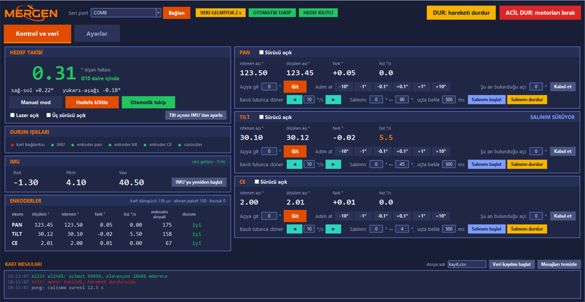
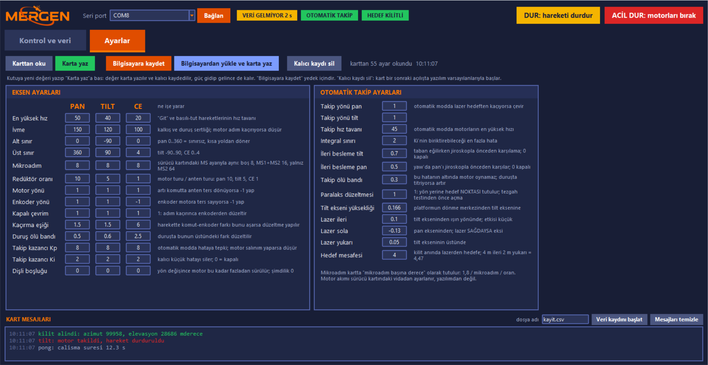

# MERCOM-1: hareket hâlinde uydu terminali (SoTM) prototipi

MERCOM-1, hareketli bir platform üzerine yerleştirilen anteni sabit bir hedefe kilitli tutan üç eksenli bir yönlendirme düzeneğidir. Taban yalpalarken ya da dönerken anten başlığındaki IMU yönelimi ölçer. Gömülü yazılım bu ölçüme göre pan, tilt ve CE (çapraz elevasyon) motorlarını sürer ve antenin eksenindeki lazeri hedef noktada tutar. Düzenek bilgisayardaki arayüzden USB ya da LoRa kablosuz bağlantıyla kontrol edilir.

Bu depo kartın gömülü yazılımını, masaüstü kontrol arayüzünü ve geliştirme sırasında yazılan test araçlarını içerir.


*Masaüstü arayüz, kontrol ve veri sekmesi (görüntüdeki değerler örnek veridir).*

## Özellikler

**Hareket ve takip**
- Üç eksen: **pan** (0–360°, sınırsız, hedefe kısa yoldan döner), **tilt** (−90…90°) ve **CE** (0–4°, küçük yanal düzeltmeler).
- **Otomatik takip:** hedef yönü bir kez kilitlenir. Taban hareket ettikçe IMU'dan gelen sapma PI denetleyiciyle düzeltilir.
- **Jiroskop ileri beslemesi:** tabanın dönüş hızı hata oluşmadan önce karşılanır. Pan ve tilt için katsayılar ayrı ayarlanır.
- **Paralaks düzeltmesi:** lazerin dönme ekseninden uzaklığı ve hedef mesafesi hesaba katılır; yön yerine hedef noktası tutulur.
- Ölü bant ve integral sınırı. Bayat IMU verisi gelirse eksenler bulundukları konumda tutulur.
- **Manuel mod:** açıya git, ±0,1/1/10° adım, basılı tutunca dönme, iki açı arasında salınım.

**Güvenilirlik**
- **Kapalı çevrim:** motor milindeki manyetik enkoder adım kaçırmayı yakalar ve konumu düzeltir.
- **CE konum tutma:** CE ekseni otomatik modda enkoderle kilit açısında tutulur.
- **IMU kurtarma:** IMU akışı 300 ms kesilirse önce I2C hattı, yetmezse sensör yeniden başlatılır.
- **Bekçi köpeği (watchdog):** ana döngü takılırsa kart kendini yeniden başlatır ve açılışta sebebini bildirir.
- **Kalıcı parametreler:** 78 parametre flash belleğe kaydedilir, güç gidip gelince son hâliyle açılır.
- **DUR ve ACİL DUR:** DUR rampalı durdurur; ACİL DUR sürücüleri anında kapatır.

**Haberleşme**
- USB seri ve LoRa (E22-900T22D, 9,6 kbps, LBT) üzerinden aynı protokol.
- Çerçeve yapısı ve CRC16 denetimi; komutlara onay (ACK) mesajı.
- 84 baytlık telemetri paketi.

## Donanım

| Bileşen | Model |
|---|---|
| Denetleyici | Teensy 4.1 (ana kart); ilk sürüm STM32 Nucleo-H753ZI |
| Motorlar | 3 × NEMA17 adım motoru; pan 1:10, tilt 1:5 redüktörlü, CE doğrudan |
| Sürücüler | 3 × TMC2209 (STEP/DIR/EN, 8 mikroadım) |
| Enkoderler | 3 × AS5048A manyetik enkoder (SPI) |
| IMU | BNO085 (I2C, Game Rotation Vector, 100 Hz) |
| Kablosuz | 2 × E22-900T22D LoRa (terminal + yer istasyonu köprüsü) |
| Lazer | 5 mW, MOSFET ile anahtarlanır |

Pin planı ve bağlantı kuralları: [MERCOM1_OZELLIKLER.md](MERCOM1_OZELLIKLER.md).

## Yazılım mimarisi

| Katman | Dosyalar | Görev |
|---|---|---|
| Donanım | `src/hw.cpp` (Nucleo), `src/hw_teensy.cpp` | Zamanlayıcılar, pinler, yazılım SPI, bekçi köpeği, kalıcı bellek |
| Sürücüler | `src/drv/` | `stepgen` 20 kHz adım üreteci (DDA), `as5048a`, `bno085`, `tmc2209` |
| Kontrol | `src/ctrl/axis.c`, `src/ctrl/pointing.c` | Trapez hız profili, sınırlar, kapalı çevrim; takip, ileri besleme, paralaks |
| Uygulama | `src/app/` | Protokol, çerçeve ayrıştırıcı, parametre tablosu, durum makinesi, telemetri |
| Giriş | `src/main.cpp` | Kurulum, ana döngü, komut işleme |

Adım üretimi 20 kHz'lik, kontrol döngüsü 1 kHz'lik zamanlayıcı kesmesinde çalışır. Algoritma kodu (`app`, `ctrl`, `drv/stepgen`) düz C'dir ve karta bağımlı değildir. Kart değişince yalnız `hw` katmanı yeniden yazılır.

## Kurulum ve çalıştırma

1. VS Code'a PlatformIO eklentisini kurun ve bu klasörü açın.
2. Derleyip yükleyin:
   ```
   pio run -e teensy41 -t upload        # Teensy 4.1
   pio run -e nucleo_h753zi -t upload   # Nucleo-H753ZI
   ```
3. Arayüz için Python 3 ve `pip install pyserial` gerekir:
   ```
   python tools/mercom_gui.py
   ```
   Seri portu listeden seçip "Bağlan"a basın. LoRa ile bağlanmak için yer istasyonu köprüsünün (`tools/lora_koprusu/`) portu seçilir.

## Arayüz

**Kontrol ve veri:**
- Nişan hatası: Ø10 ve Ø20 hedef çemberlerine göre renkli gösterilir.
- Mod düğmeleri (manuel, hedefe kilitle, otomatik takip).
- Durum ışıkları, IMU açıları, enkoder tablosu.
- Her eksen için hareket kartı.
- Kart mesajları ve CSV veri kaydı.

**Ayarlar:** eksen ve takip parametreleri karttan okunur, karta yazılır, bilgisayara kaydedilir (`tools/params.json`).


*Ayarlar sekmesi.*

## Protokol

Çerçeve: `A5 | LEN | ID | PAYLOAD | CRC16 lo | CRC16 hi`.
- CRC16-CCITT, LEN'den PAYLOAD sonuna kadar hesaplanır.
- Sayılar little-endian.

| ID | Yön | Yük | Anlam |
|---|---|---|---|
| 0x01 | PC→MCU | — | ping |
| 0x02 | PC→MCU | u8 mode | 1 MANUAL, 2 AUTO |
| 0x03 | PC→MCU | u8 axis, f32 dps | hız modunda dönme, 0 durdurur |
| 0x04 | PC→MCU | u8 axis, f32 deg | açıya git |
| 0x05 / 0x06 | PC→MCU | — | kilitle / bırak |
| 0x07 | PC→MCU | u8 | lazer |
| 0x08 / 0x09 | PC→MCU | u16 id (+ f32) | parametre oku / yaz |
| 0x0A | PC→MCU | — | parametreleri kalıcı kaydet |
| 0x0B | PC→MCU | u8 | motor sürücüleri EN |
| 0x0C | PC→MCU | u16 Hz | telemetri hızı |
| 0x0D | PC→MCU | — | tüm eksenleri durdur |
| 0x0E | PC→MCU | — | arızayı temizle |
| 0x81 | MCU→PC | u32 ms, u32 ver | pong |
| 0x82 | MCU→PC | telem_t 84 B | telemetri |
| 0x83 | MCU→PC | u16 id, f32, u8 ok | parametre değeri |
| 0x84 | MCU→PC | metin | log satırı |
| 0x85 | MCU→PC | u8 id, u8 durum | onay |

Tam komut listesi: [MERCOM1_KOD_VE_PARAMETRELER.md](MERCOM1_KOD_VE_PARAMETRELER.md).

## Klasörler

```
src/                 gömülü yazılım (hw, drv, ctrl, app)
lib/Adafruit_BNO08x  BNO085 kütüphanesi (projeye göre yamalı, bkz. MERCOM_YAMA.md)
tools/               arayüz, LoRa köprüsü ve ayar betikleri, donanım test programları ve test betikleri
docs/                README görselleri
```

## Belgeler

- [MERCOM1_SISTEM_TAM_ACIKLAMA.md](MERCOM1_SISTEM_TAM_ACIKLAMA.md): sistemin baştan sona anlatımı
- [MERCOM1_YAZILIM_ACIKLAMA.md](MERCOM1_YAZILIM_ACIKLAMA.md): yazılımın çalışma mantığı
- [MERCOM1_EKSENLER_VE_KOD.md](MERCOM1_EKSENLER_VE_KOD.md): eksenler ve kod
- [MERCOM1_KOD_VE_PARAMETRELER.md](MERCOM1_KOD_VE_PARAMETRELER.md): parametreler, protokol, kullanım
- [MERCOM1_OZELLIKLER.md](MERCOM1_OZELLIKLER.md): donanım, pin planı, kararlar ve test geçmişi
